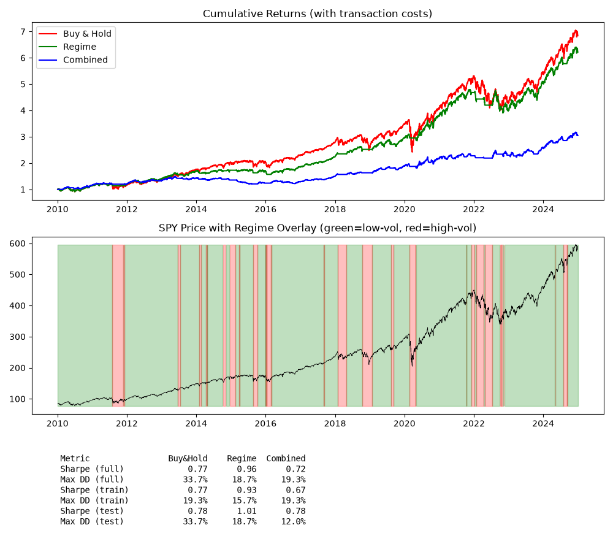
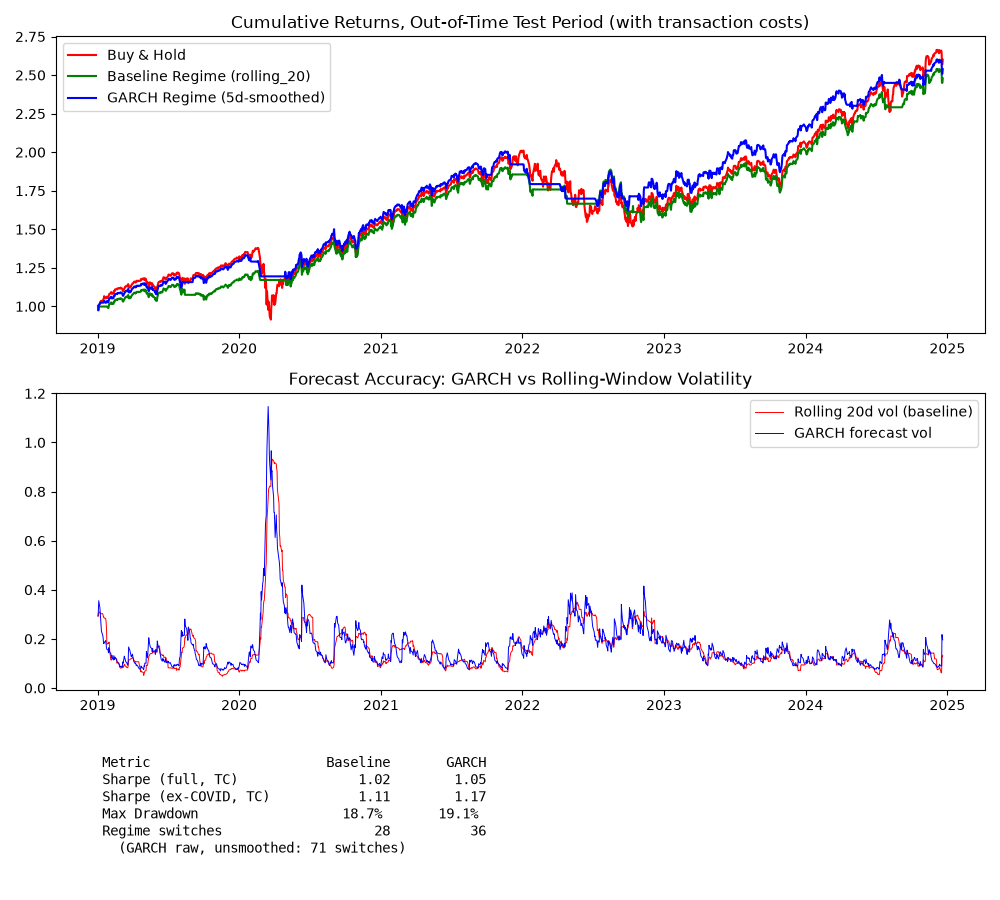

# regime-momentum-signal

Volatility regime detection, momentum, and GARCH volatility forecasting — a systematic signal study on SPY

## Motivation

Build a systematic signal that adapts to volatility regimes, as a way to develop hands-on research and backtesting
skills beyond theoretical risk modeling. The project has three connected parts: establishing the statistical basis for
a volatility-regime rule, backtesting that rule (with and without a momentum overlay), and testing whether *forecasting*
next-period volatility with a GARCH model produces a better-timed signal than reacting to trailing volatility.

## Data

SPY + VIX + 3-month T-bill (^IRX), daily, 2010-2024, via yfinance. SPY prices are
the dividend-adjusted Close, so returns are total returns with dividends reinvested.

**Setup:** run `data_download.py` first to fetch the data locally into `data/`
before running `parameter_robustness_exploration.py` or `backtest.py`. Data files are not tracked in this
repository and are regenerated by this script.

## Usage

1. `python data_download.py` — fetch SPY, VIX, IRX data into `data/`
2. `python backtest.py` — run the regime + momentum strategy, backtest with
   transaction costs, train/test split, and generate the performance tearsheet
3. `python exploratory_analysis.py` — (optional) initial exploratory analysis: returns,
   rolling volatility, volatility clustering investigation (AR(1) fit, residual ACF, ARCH-LM test)
4. `python parameter_robustness_exploration.py` — (optional) reproduces the
   threshold/window sensitivity analysis referenced in Methodology
5. `python volatility_forecasting.py` — fits a GARCH(1,1)-t model, evaluates its one-day-ahead volatility
   forecast against the trailing-window baseline, and backtests a forecast-based regime signal (see "Forecasting the
   volatility signal" below)

## Methodology

**Volatility clustering (statistical basis):** the regime approach assumes volatility is persistent enough to be
predictable, even though returns are largely not. Fitting an AR(1) to daily SPY returns gives a lag-1 coefficient of
−0.100 (std err 0.016, z = −6.19) — highly significant given n=3,772, but explaining roughly 1% of return variance, so
economically marginal rather than exploitable. A handful of residual autocorrelations remain marginally significant at
longer lags, but all are small in magnitude, and both AIC and BIC favour AR(1) over higher-order specifications
(AR(1) AIC −23,523 vs AR(5) −23,505). Squared residuals behave very differently: autocorrelation of roughly 0.38 at
lag 1, peaking at 0.50 at lag 2, and still around 0.13 at lag 20 — every lag well outside the confidence band — with
Engle's ARCH-LM test rejecting the null of no ARCH effect (p < 1e-260). Returns carry little exploitable structure in
level; volatility carries a great deal. See `figures/acf_returns_residuals.png` and
`figures/acf_squared_residuals.png`; reproduced by `exploratory_analysis.py`.

**Regime detection:** short-term volatility (20-day rolling) compared against long-term volatility. Two long-window
specifications were evaluated: 60-day (one quarter) and 252-day (one trading year). The 252-day specification was
selected as it produced more persistent regimes and more stable switch counts across threshold values — the 20d/60d
specification showed a sharp sensitivity to threshold choice (186 switches at 1.1 vs 45 at 1.4), while the 20d/252d
specification was more robust (106 at 1.1 vs 47 at 1.4).

**Parameter robustness:** thresholds from 1.1 to 1.4 were tested on both window pairs, on the full 2010-2024 sample.
Across 1.2-1.4
the 20d/252d switch count falls from 61 to 55 to 47 (about -23% end to end) against 135, 65 and 45 for 20d/60d (about
-67%), so the
regime frequency is much less threshold-sensitive with the 252-day window; at the chosen threshold it is about 4
switches per year.
A threshold of 1.2 was selected from this switch-count analysis (strategy performance was not used to choose it;
performance sensitivity to
the threshold was not tested). Regime persistence is approximately 3 months on average.

**Forecasting the volatility signal:** the regime rule above reacts to *trailing* 20-day volatility — it only registers
a
regime shift after volatility has already moved. A natural extension is to ask whether *forecasting* next-period
volatility,
rather than measuring it in arrears, produces a better-timed signal. A GARCH(1,1) model with Student-t errors was fitted
for this purpose. The t-distribution is decisively preferred over Normal errors (AIC 9,364 vs 9,570; ν≈4.9 in the
2010–2018 fit used for forecasting, 5.6 on the full sample — confirming
the
fat tails already established statistically above), and its persistence parameters (α≈0.17, β≈0.82, α+β≈0.99) quantify
the
same volatility clustering the ARCH-LM test detected. The AIC comparison uses the full 2010–2024 sample.
The model was fitted on 2010-2018 only and used to forecast
one-day-ahead conditional variance across a held-out 2019-2024 test period, with parameters never exposed to test data.
See `volatility_forecasting.py`.

## Signals

**Regime signal:** `regime = +1` when `rolling_20 < rolling_252 * 1.2` (low vol),
`0` otherwise (high vol). Approximately 4 regime switches per year over 2010-2024.

**Position:** long SPY when regime = +1 (low vol), cash when regime = 0 (high vol).
Signal lagged by one day to avoid lookahead bias.

**Momentum signal:** 20-day cumulative return (`spy["returns"].rolling(20).sum()`).
Positive = recent winner, negative = recent loser.

**Combined position:** long SPY only when regime = +1 (low vol) AND momentum > 0
(recent winner). Otherwise cash. Signal lagged by one day to avoid lookahead bias.

**Forecast-based regime signal:** the same regime rule, but with the trailing 20-day volatility
replaced by the GARCH one-day-ahead volatility forecast (5-day trailing-smoothed — see Results for
why smoothing is necessary). `regime = +1` when `garch_forecast_vol_smoothed < rolling_252 * 1.2`.
The forecast smoothing uses a trailing window only, introducing no lookahead.

## Backtest

**Period:** 2010-2024, daily rebalancing.  
**Benchmark:** SPY buy-and-hold.  
**Risk-free rate:** 3-month US T-bill (^IRX), converted to daily decimal.

| Metric                              | Buy & Hold | Regime Strategy | Combined Strategy |
|-------------------------------------|------------|-----------------|-------------------|
| Cumulative return (no TC)           | 6.84x      | 6.61x           | 4.01x             |
| Cumulative return (with TC)         | 6.84x      | 6.22x           | 3.05x             |
| Sharpe ratio (no TC)                | 0.77       | 0.99            | 0.91              |
| Sharpe ratio (with TC, 0.1%/switch) | 0.77       | 0.96            | 0.72              |
| Max drawdown (no TC)                | 33.7%      | 17.8%           | 14.3%             |
| Max drawdown (with TC)              | 33.7%      | 18.7%           | 19.3%             |
| Regime switches                     | —          | 61              | 275               |

**Sensitivity to the cost per switch (regime strategy, full sample):**

| Cost per switch   | 0bp   | 5bp   | 10bp  | 20bp  | 100bp |
|-------------------|-------|-------|-------|-------|-------|
| Sharpe ratio      | 0.99  | 0.98  | 0.96  | 0.93  | 0.65  |
| Cumulative return | 6.61x | 6.41x | 6.22x | 5.85x | 3.58x |

The regime strategy's Sharpe ratio stays above buy-and-hold (0.77) up to roughly 65–70bp per switch; the 10bp assumption
is conservative for a liquid ETF such as SPY.

**Train/test split (with TC):**

| Metric       | Period            | Buy & Hold | Regime Strategy | Combined Strategy |
|--------------|-------------------|------------|-----------------|-------------------|
| Sharpe ratio | Train (2010-2018) | 0.77       | 0.93            | 0.67              |
| Sharpe ratio | Test (2019-2024)  | 0.78       | 1.01            | 0.78              |
| Max drawdown | Train (2010-2018) | 19.3%      | 15.7%           | 19.3%             |
| Max drawdown | Test (2019-2024)  | 33.7%      | 18.7%           | 12.0%             |

**Forecast-based regime vs trailing-volatility baseline (out-of-sample test period, 2019-2024, with TC):**

| Metric                          | Trailing-vol regime | GARCH-forecast regime (smoothed) |
|---------------------------------|---------------------|----------------------------------|
| Sharpe ratio (full test period) | 1.021               | 1.055                            |
| Sharpe ratio (excluding COVID)  | 1.107               | 1.169                            |
| Max drawdown                    | 18.7%               | 19.1%                            |
| Regime switches (full)          | 28                  | 36                               |

The trailing-volatility Sharpe here (1.021) differs slightly from the train/test table above (1.01) because this
sample excludes the last five trading days of 2024, which have no forward target.

**Sensitivity to the cost per switch (out-of-sample test period, 2019-2024):**

| Cost per switch              | 0bp    | 5bp    | 10bp   | 20bp   |
|------------------------------|--------|--------|--------|--------|
| Trailing-vol regime Sharpe   | 1.056  | 1.038  | 1.021  | 0.986  |
| GARCH-forecast regime Sharpe | 1.099  | 1.077  | 1.055  | 1.011  |
| Difference                   | +0.043 | +0.039 | +0.034 | +0.025 |

The GARCH advantage shrinks as costs rise because it switches more often (36 vs 28), but stays positive across this
range.

## Results

**Summary: the regime signal alone is robust and adds value; the momentum
combination, as currently specified, does not.**

See the Performance Tearsheet above for the equity curves, the regime overlay on price, and the full train/test metrics
breakdown.

The regime strategy gives up about 9% of buy-and-hold's terminal wealth net of costs
(6.22x vs 6.84x) while improving the Sharpe ratio (0.96 vs 0.77) and cutting maximum
drawdown by about 45% (18.7% vs 33.7%). The
strategy underperforms during the sustained low-volatility bull market post-2018,
but the volatility filter's drawdown protection during stress periods largely
compensates.

Adding a 20-day momentum filter (invest only when regime = low vol AND 20-day
return > 0) significantly reduces cumulative return before costs (4.0x vs 6.6x for regime-only)
despite marginally improving max drawdown (14.3% vs 17.8%, before costs). The 20-day momentum
signal is too noisy as a binary filter — it generates frequent unnecessary exits
within calm regimes, missing upside in a generally trending market. A longer
momentum window or continuous position sizing rather than binary filtering would
be more appropriate — left for future work.

Accounting for transaction costs (0.1% per position change) confirms the regime
strategy's benefit is largely robust — cumulative return drops modestly from
6.61x to 6.22x (Sharpe 0.99 to 0.96) given its 61 switches over 15 years. The
combined regime+momentum strategy fares much worse: switching 275 times —
4.5x more often, since both the regime and momentum signals must independently
align — means transaction costs erode cumulative return from 4.01x to 3.05x
(Sharpe 0.91 to 0.72), now clearly below buy-and-hold on both metrics. This is
an important finding: a signal that looks marginally useful gross of costs
can become value-destructive once realistic trading costs are included,
reinforcing why the naive momentum combination is not adopted as currently
specified.

A train/test split (train 2010-2018, test 2019-2024) is consistent with the regime
strategy's robustness: it improves Sharpe over buy-and-hold in both periods
(0.77→0.93 train, 0.78→1.01 test) and reduces max drawdown in both (19.3%→15.7%
train, 33.7%→18.7% test). This is a stability check, not a clean out-of-sample test: the window and threshold were
chosen from full-sample switch-count analysis (not from strategy performance). The combined strategy is less
consistent — it
underperforms buy-and-hold on Sharpe in the train period (0.67 vs 0.77) but
matches it in test (0.78 vs 0.78), while offering better drawdown
protection in the test period only (negligible in train). This period-dependence, combined with the
transaction cost sensitivity already noted, suggests the regime signal alone
is the more robust and reliable component of this research.

**Can forecasting the volatility signal do better?**
Out-of-sample (parameters fitted pre-2019), the GARCH one-day-ahead forecast is compared with the trailing 20-day
estimate against three realized-variance targets: the next-day squared return, the next-day squared return excluding the
February–April 2020 crisis, and the average squared return over the next five days. Two losses are used: RMSE and QLIKE.
QLIKE is the more informative one here, because squared returns are a very noisy proxy and RMSE is dominated by a few
extreme days. GARCH has lower QLIKE on all three targets (1.45 vs 1.57 on the full sample; 1.45 vs 1.55 excluding the
crisis; 0.42 vs 0.55 on the five-day target) and lower RMSE on two of them (4.8e-4 vs 5.5e-4 on the full sample; 3.5e-4
vs 4.2e-4 on the five-day target). Excluding the crisis, single-day RMSE is indistinguishable (2.105e-4 for both), which
suggests that GARCH’s single-day RMSE advantage comes mainly from the crisis period. In the one episode inspected (the
February 2020 onset), the GARCH forecast registered elevated volatility a day ahead of the trailing window; this single
example is illustrative, not a systematic lead-lag result.

Whether that forecasting advantage translates into a better *strategy* is a separate
question. Substituting the raw GARCH forecast for trailing volatility in the regime rule
initially produced far more switching (71 vs 28 over the test period) — the forecast is
more responsive to genuine regime shifts but also to daily noise, the same failure mode
that undermines the momentum filter. Applying a 5-day trailing smoother to the forecast
before thresholding cuts this to 36 (34 excluding the crisis).
The 5-day window was chosen a priori as one trading week; no other window was tried.
The smoothed forecast-based regime then
modestly outperforms the trailing-volatility baseline on risk-adjusted return over the
out-of-sample period (Sharpe 1.055 vs 1.021 with transaction costs; 1.169 vs 1.107 excluding
the COVID crisis), at the cost of slightly more switching and marginally higher drawdown.
The accuracy advantage is accompanied by a small Sharpe improvement (+0.03 with costs, +0.06 excluding
COVID), which is within sampling noise; the forecast-accuracy result is the finding and the strategy gain is
suggestive. This mirrors the momentum finding
from the other direction: a more *responsive* signal is not automatically a better one, and controlling its reactivity
(here via smoothing) is what allows its underlying quality to show through net of costs.

See the GARCH Tearsheet above for the out-of-sample equity curves, the forecast-vs-baseline overlay, and the full
metrics comparison.

## Limitations

- Momentum combination is not currently viable: naive 20-day binary filter is
  too noisy, degrades performance after transaction costs, and shows
  inconsistent results across train/test periods — not adopted as currently specified
- Regime filter reduces absolute returns vs buy-and-hold, particularly post-2018
  in sustained low-vol bull markets — a real cost of the drawdown protection
- The GARCH-forecast regime’s Sharpe improvement over the trailing-volatility rule is small (about 0.03 over roughly six
  years of out-of-sample data), within sampling noise, and comes with marginally higher drawdown; whether it justifies
  the added model complexity is a judgment call, not a clear win. The forecast-accuracy improvement is the more reliable
  result.
- Conventions: trades execute at the close that generated the signal; cash earns zero in the strategy returns while
  Sharpe ratios subtract the T-bill rate (conservative); the regime defaults to long until the 252-day window fills
  (about the first year); switch counts include the first row (initial entry), so true regime changes are one fewer;
  the ex-COVID figures are computed after removing the 15 Feb–30 Apr 2020 rows from the test period, so the one-day
  signal lag bridges that gap once.
- Momentum crashes: any future momentum-based signal remains vulnerable to sharp
  market reversals (e.g. COVID 2020) where recent winners become losers rapidly
- Regime changes: when the macro environment shifts fundamentally (rate cycle
  reversal, recession onset), past volatility patterns may stop being predictive
- Volatility clustering is established statistically, but that only confirms
  persistence exists — it does not establish that a 20d/252d ratio rule is the
  best way to exploit it
- Crowding: if too many participants run similar strategies, the edge erodes
- Horizon sensitivity: momentum (if used) only works at 3-12 month horizons
- Single asset (SPY) over one sample period (2010-2024, a prolonged bull market with one major crash); no other markets
  or regimes tested
- Past performance doesn't guarantee future regimes/results

